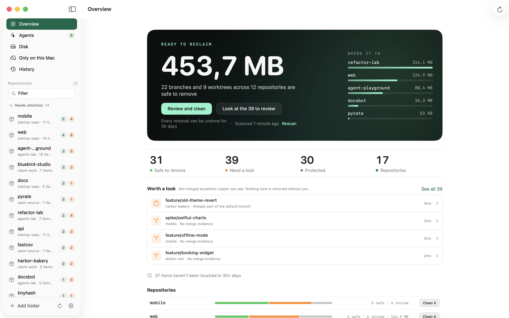
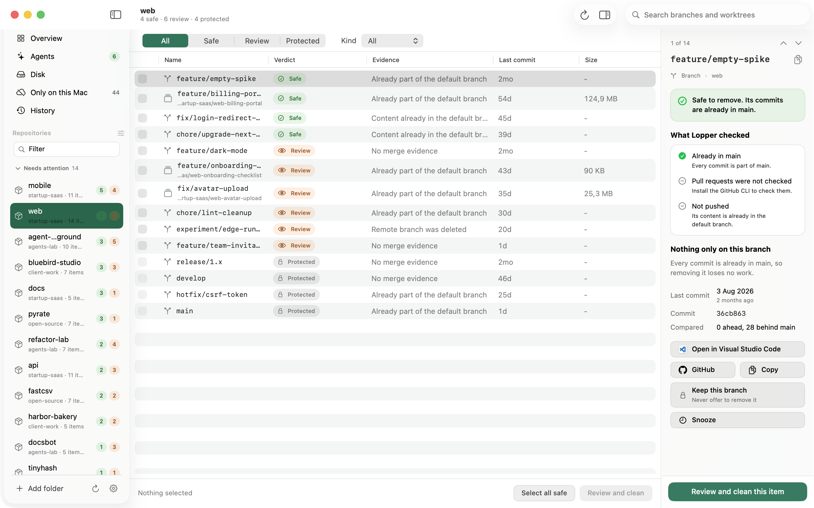
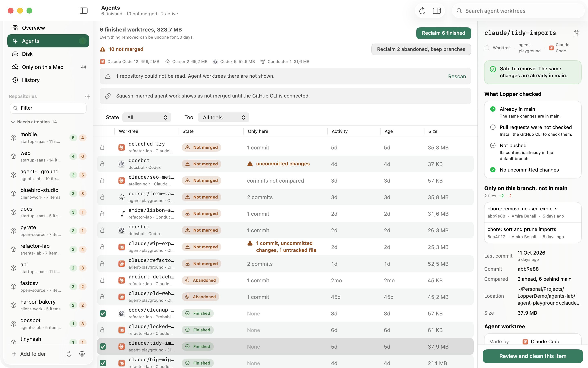
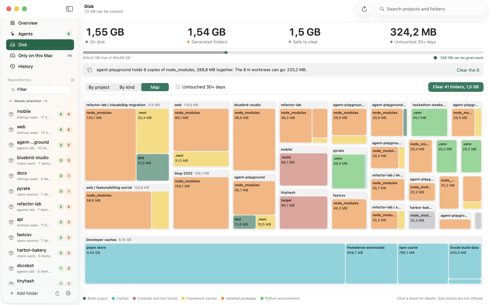
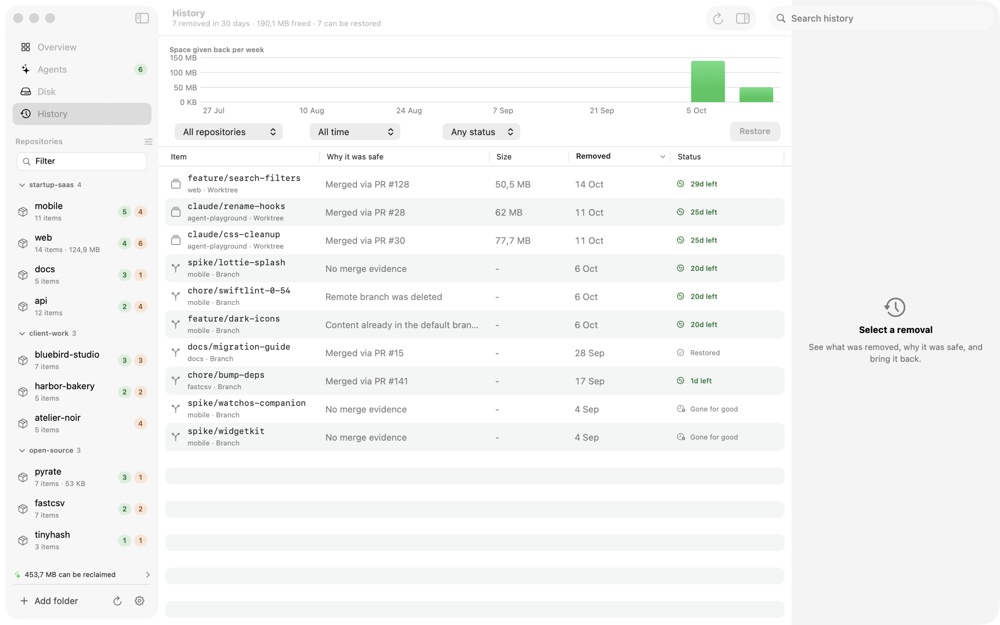

<div align="center">


# Lopper

**Keep your repositories light.**<br>
Finds the branches, worktrees and generated folders you no longer need, shows why each one is safe to remove,<br>
and lets you undo anything for 30 days.

[](https://github.com/Zawalid/Lopper/releases/latest)
[](https://github.com/Zawalid/Lopper/actions/workflows/ci.yml)
[](LICENSE)


[Website](https://lopper.zawalid.com) &nbsp;·&nbsp; [Download](https://github.com/Zawalid/Lopper/releases/latest) &nbsp;·&nbsp; [Install guide](docs/install.md) &nbsp;·&nbsp; [How it stays safe](#how-it-stays-safe) &nbsp;·&nbsp; [Build from source](#build-from-source) &nbsp;·&nbsp; [Roadmap](docs/roadmap.md)

<br>

<picture>
  <source media="(prefers-color-scheme: dark)" srcset="docs/images/overview-dark.png">
  
</picture>

</div>

<br>

## Why

If you work in many repositories, especially with AI coding agents, the leftovers pile up quietly: merged branches nobody
deleted, worktrees from agents that finished days ago, a `node_modules` in every copy. Cleaning them by hand means
checking each one, and one wrong force delete loses work.

Lopper does the checking for you. For every branch, worktree and generated folder it shows a verdict and the git
evidence behind it, you review a list, and everything it removes can be restored.

## Features

<table>
<tr>
<td width="50%" valign="top">

**Branches and worktrees**<br>
Merged branches and finished worktrees are marked safe, each with the evidence: already in the default branch, merged
through a pull request, remote branch deleted. Anything that holds work found nowhere else is protected or flagged.

</td>
<td width="50%" valign="top">

**Agents**<br>
Worktrees left behind by Claude Code, Cursor, Codex and Conductor: how old they are, whether they hold unmerged or
uncommitted work, and which are finished and can be reclaimed in one step.

</td>
</tr>
<tr>
<td width="50%" valign="top">

**Disk**<br>
Generated folders (`node_modules`, build output, caches) by project, by kind, or as a map, plus developer caches
outside your projects. Clearing moves to the Trash; reinstalling is optional.

</td>
<td width="50%" valign="top">

**History and undo**<br>
Every removal is logged with the reason it was safe. Restore one item or a whole cleanup within 30 days; branches come
back at their exact commit.

</td>
</tr>
<tr>
<td width="50%" valign="top">

**Rules, offer only**<br>
"Branches merged more than 14 days ago", "projects untouched for 60 days". Rules suggest, a weekly digest reminds you,
and nothing is ever removed without you confirming a list.

</td>
<td width="50%" valign="top">

**Built for the Mac**<br>
Native SwiftUI, a menu bar popover, a command palette (Command-K), onboarding that finds your project folders, light and
dark appearance. No account, no analytics, no network calls of its own.

</td>
</tr>
</table>

<br>

<table>
<tr>
<td width="50%"><picture>
  <source media="(prefers-color-scheme: dark)" srcset="docs/images/repository-dark.png">
  
</picture></td>
<td width="50%"><picture>
  <source media="(prefers-color-scheme: dark)" srcset="docs/images/agents-dark.png">
  
</picture></td>
</tr>
<tr>
<td width="50%"><picture>
  <source media="(prefers-color-scheme: dark)" srcset="docs/images/disk-map-dark.png">
  
</picture></td>
<td width="50%"><picture>
  <source media="(prefers-color-scheme: dark)" srcset="docs/images/history-dark.png">
  
</picture></td>
</tr>
</table>

## How it stays safe

Lopper's one job is to never remove work that exists nowhere else.

| It will | Only when |
|---|---|
| Offer a branch as safe | git confirms its commits are already in the default branch, or a pull request merged them (with the GitHub CLI) |
| Offer a worktree as safe | it has no uncommitted changes and no commits that exist nowhere else |
| Clear a generated folder | it is git-ignored, it is not a symlink, and it is checked again right before it moves to the Trash |
| Remove anything at all | you reviewed the list and confirmed it |
| Delete for good | it is something Lopper itself moved to the Trash, and you asked for it |

Every removal can be undone for 30 days from History. Rules only ever suggest. About 650 automated tests back this,
many of them against real git repositories created on the fly, because mocking git would hide exactly the cases that
lose work.

## Install

**Download.** Get the DMG from [Releases](https://github.com/Zawalid/Lopper/releases/latest) and drag Lopper to
Applications.

```bash
brew install --cask zawalid/lopper/lopper    # or with Homebrew
```

macOS blocks the first launch because Lopper is not signed with an Apple Developer ID. Open it once, then go to
**System Settings, Privacy & Security, Open Anyway** (the Homebrew install skips this). The steps, updating and
uninstalling are in the **[install guide](docs/install.md)**.

**Requirements:** macOS 14 or later, and git (`xcode-select --install`). The [GitHub CLI](https://cli.github.com)
(`gh`) is optional and adds pull request based merge detection.

## Command line

The same engine is available in the terminal as `lop`, sharing the app's folders and undo history:

```bash
brew install zawalid/lopper/lop
lop scan                 # what can be removed, repository by repository
lop why feature/old-2    # the git evidence for one branch
lop clean                # review the plan, confirm, remove; undo with `lop undo --last`
lop agents               # worktrees left by Claude Code, Cursor, Codex and Conductor
```

Every command has `--json` for scripts and AI agents. See the [command line guide](docs/cli.md).

## Quick start

1. **Open Lopper.** Pick your project folders from the suggestions, or let it search your Mac.
2. **Read the overview.** One number says how much you can reclaim; the list shows where it is.
3. **Review and clean.** Look at the list, uncheck anything you want to keep, confirm.
4. **Undo if you change your mind.** The toast offers it straight away, and History keeps it for 30 days.

## Build from source

You need Xcode 16 or later and [XcodeGen](https://github.com/yonaskolb/XcodeGen).

```bash
git clone https://github.com/Zawalid/Lopper.git
cd Lopper
scripts/dev.sh                # build a Debug app and open it; add --watch to relaunch on save
swift test                    # engine tests
cd App && xcodegen generate && xcodebuild test -project Lopper.xcodeproj -scheme Lopper -destination 'platform=macOS'
```

Try it on throwaway data instead of your own repositories:

```bash
scripts/demo-world/build.sh ~/LopperDemo
scripts/demo-world/run.sh
```

| | |
|---|---|
| `Sources/Lopper` | the engine, no UI: scanning, classification, cleaning, undo |
| `Tests/LopperTests` | engine tests, using real git repositories |
| `App/LopperApp` | the SwiftUI app |
| `scripts` | dev loop, release, demo world |
| `docs` | [development](docs/development.md), [releasing](docs/releasing.md), [settings file](docs/settings-file.md), [roadmap](docs/roadmap.md) |

## FAQ

<details>
<summary><b>Can it delete my unmerged work?</b></summary>

No. A branch or worktree holding commits that exist nowhere else is never offered as safe. If Lopper cannot prove
something is merged, it shows "needs a look" and lets you decide. Even then, removed branches are restorable from History
at their exact commit.

</details>

<details>
<summary><b>Does it send anything anywhere?</b></summary>

No. There is no account, no analytics and no crash reporting. Lopper only runs `git` (and `gh`, if you have it) on your
machine, and reads the folders you chose.

If something goes wrong, Settings, About, Diagnostics shows the report a bug report would contain, with repository and
branch names left out unless you include them. You copy or save it yourself; Lopper never sends it.

</details>

<details>
<summary><b>Why does macOS warn me on the first launch?</b></summary>

The app is not signed with an Apple Developer ID, so macOS Gatekeeper blocks it the first time. Open it, then choose
**Open Anyway** in System Settings, Privacy & Security; you only do this once. The
[install guide](docs/install.md) has the steps. Lopper is open source, so you can read it or build it yourself.

</details>

<details>
<summary><b>Which AI tools does it understand?</b></summary>

Claude Code, Cursor, Codex and Conductor worktrees are recognized by their layout, with the tool shown next to each one.
Worktrees from other tools are still handled as ordinary git worktrees.

</details>

<details>
<summary><b>Where does it keep its data?</b></summary>

In `~/Library/Application Support/Lopper`: your settings as a readable JSON file and the undo log. See the
[settings file format](docs/settings-file.md).

</details>

## Roadmap

Remote branch cleanup, stash handling, GitLab and Bitbucket merge detection, a `lop` command line tool and in-app updates
are next. The full list is in the [roadmap](docs/roadmap.md).

## Contributing

Issues and pull requests are welcome. Read [CONTRIBUTING.md](CONTRIBUTING.md) first; changes to anything that removes
things need tests that prove the safety rules still hold. For security problems see [SECURITY.md](SECURITY.md).

## Author

Made by [Walid Zakan](https://zawalid.com) &nbsp;·&nbsp; [GitHub](https://github.com/Zawalid) &nbsp;·&nbsp; [X](https://x.com/Zawaalid)

## License

[MIT](LICENSE)
